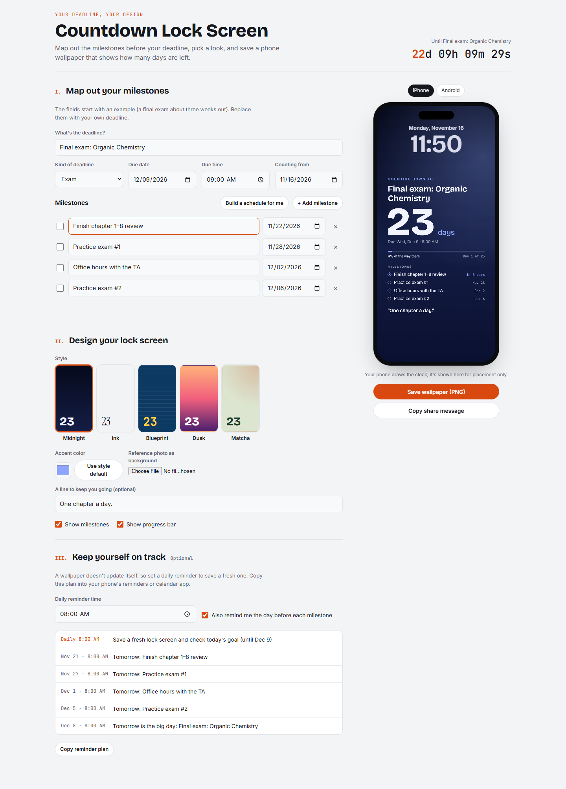
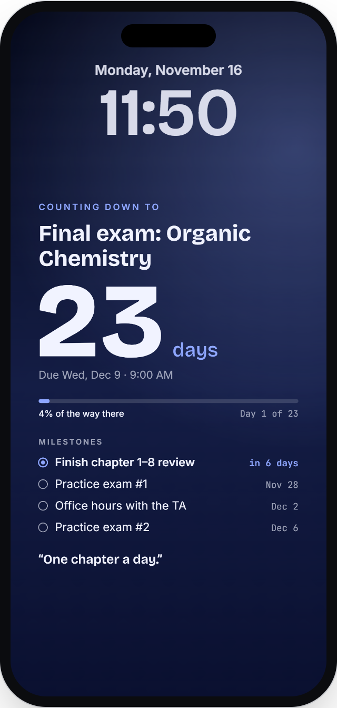
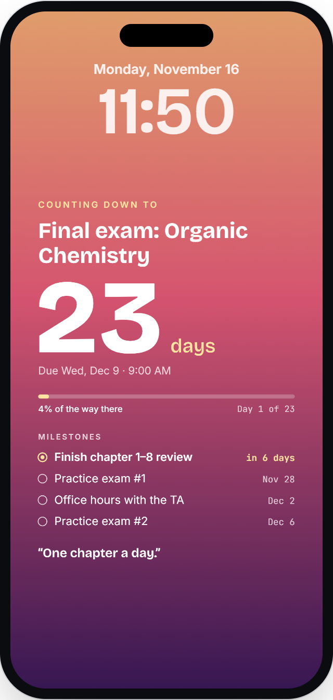
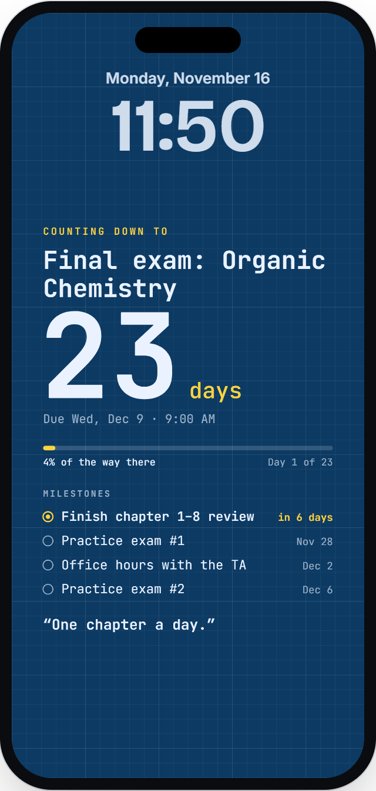
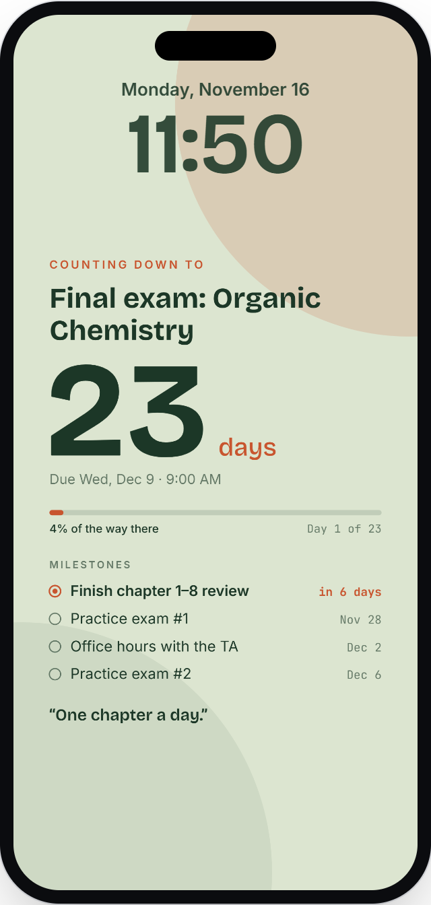
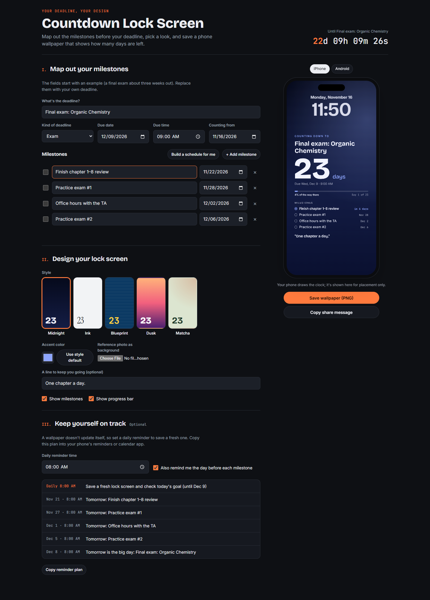
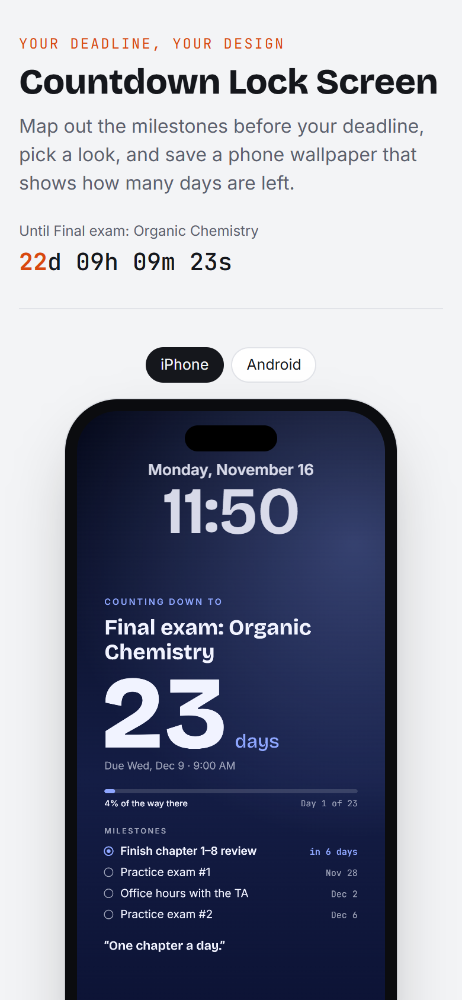

# Countdown Lock Screen

Plan the milestones before a deadline, design a countdown wallpaper, and save it as your phone's lock screen.

Built with Next.js (App Router), React and TypeScript. Everything runs in the browser; there is no backend.

## Screenshots



### Wallpaper styles

| Midnight | Dusk | Blueprint | Matcha |
| :---: | :---: | :---: | :---: |
|  |  |  |  |

### Dark mode and mobile

| Dark mode | Mobile |
| :---: | :---: |
|  |  |

## Run locally

```bash
npm install
npm run dev
```

Open http://localhost:3000.

## Deploy to Vercel

**Option A: GitHub + Vercel dashboard**

1. Push this folder to a new GitHub repository.
2. Go to https://vercel.com/new and import the repository.
3. Keep the detected defaults (Framework: Next.js) and click **Deploy**.

**Option B: Vercel CLI**

```bash
npm i -g vercel
vercel          # preview deployment
vercel --prod   # production deployment
```

## Project structure

```
app/
  layout.tsx        fonts (next/font), metadata
  page.tsx          entry
  globals.css       all styles, light + dark theme
  icon.svg          favicon
components/
  ClientApp.tsx     loads the app in the browser only
  CountdownApp.tsx  state, saving, layout of the three steps
  MilestoneEditor.tsx
  StylePicker.tsx
  Reminders.tsx
  PhonePreview.tsx  phone frame, canvas, save/share buttons
  Ticker.tsx        live d/h/m/s countdown in the header
lib/
  draw.ts           renders the wallpaper onto a <canvas>
  presets.ts        wallpaper styles, phone sizes, milestone templates, example data
  dates.ts          date helpers and countdown math
  reminders.ts      reminder plan
  share.ts          copy to clipboard, share sheet / PNG download
  types.ts
```

## Notes

- Inputs are saved in the browser's localStorage. An uploaded background photo is not saved.
- On phones, **Save wallpaper** opens the share sheet so you can save straight to Photos. On computers it downloads a PNG.
- The wallpaper is a still image, so the day count is correct for the day you save it. The daily reminder is there to prompt a fresh save.
